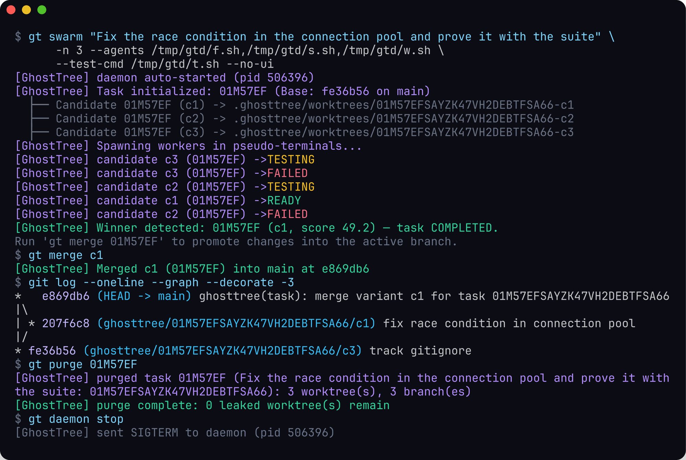
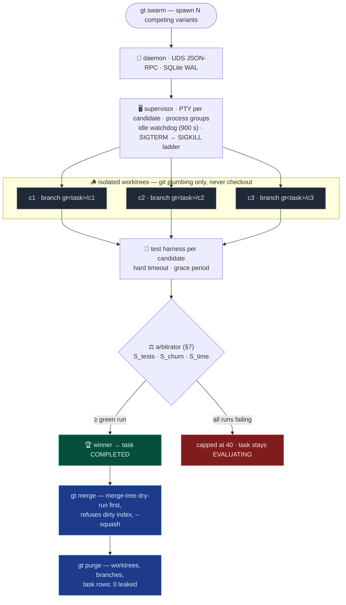

<div align="center">

```
 ██████╗ ██╗  ██╗ ██████╗ ███████╗████████╗████████╗██████╗ ███████╗███████╗
██╔════╝ ██║  ██║██╔═══██╗██╔════╝╚══██╔══╝╚══██╔══╝██╔══██╗██╔════╝██╔════╝
██║  ███╗███████║██║   ██║███████╗   ██║      ██║   ██████╔╝█████╗  █████╗
██║   ██║██╔══██║██║   ██║╚════██║   ██║      ██║   ██╔══██╗██╔══╝  ██╔══╝
╚██████╔╝██║  ██║╚██████╔╝███████║   ██║      ██║   ██║  ██║███████╗███████╗
 ╚═════╝ ╚═╝  ╚═╝ ╚═════╝ ╚══════╝   ╚═╝      ╚═╝   ╚═╝  ╚═╝╚══════╝╚══════╝
```

**Autonomous Git worktree swarm orchestrator.**
Run *N* competing agents on the same task — each in its own isolated worktree and PTY —
then let the arbitrator grade, pick, and merge the winner.

[](https://github.com/devpryan7792/ghosttree/actions/workflows/ci.yml)
[](#development)
[](https://www.rust-lang.org)
[](#license)
[](#)



*Everything above is a real run: three competing agents, one correct fix, one
hallucination, one hard crash — arbitrator picks the green one, `gt merge` promotes
it, `gt purge` leaves zero worktrees behind.*

[Getting started](#-getting-started) · [How it works](#-how-it-works) · [Scoring](#-scoring) · [CLI](#cli-reference) · [Contributing](#contributing)

</div>

---

## 🤨 Why

When autonomous agents (Claude Code, Aider, Gemini CLI, custom LLM loops) work
directly in your active working tree, three things go wrong:

1. **Branch pollution** — an agent rewriting files invalidates your editor buffers,
   LSP state, and staged changes.
2. **Sequential bottleneck** — exploring 3 architectural ideas costs `3 × T`
   back-to-back; running them in one directory causes write collisions.
3. **Destructive failures** — a hallucinating agent running `git checkout -- .`
   or `rm -rf` on *your* tree is a bad day.

GhostTree gives every agent a throwaway worktree, supervises them concurrently
over PTYs, and arbitrates the outcome with real test runs — not vibes.

## 🌲 How it works



## 🚀 Getting started

Requires **Rust 1.80+** and **git**.

```bash
cargo install --path .   # builds and installs the `gt` binary
gt init                  # provisions .ghosttree/ state inside your repo

gt swarm "Fix the race condition in the connection pool" \
  -n 3 \
  --agents "claude-code --run, aider --yes, gemini --exec" \
  --test-cmd "cargo test"
```

A live dashboard (crossterm TUI, plain streaming in pipes) follows the swarm in
real time — press **q** to detach while the agents keep working:

```
  ID       AGENT         STATUS     ELAPSED  COMMITS   TESTS   SCORE
  --------------------------------------------------------------------
  01JMW9…  claude-code   TESTING    01m 24s       2     8/8     96.4
  01JMW9…  aider         WORKING    01m 22s       5      --       --
  01JMW9…  gemini        FAILED     01m 22s       0     3/8     32.0
```

Then inspect, promote, clean up:

```bash
gt diff c1             # unified diff vs. the task's base commit
gt diff c1 --stat      # or just the counters
gt eval <task> --re-run    # re-execute the test command and re-arbitrate
gt merge c1                # merge-tree dry-run first; refuses a dirty index
gt merge c1 --squash       # or fold the variant into a single commit
gt merge c1 --autostash    # snapshots your dirty tree via git stash
gt purge                   # remove worktrees, branches, task rows (all or per-task)
```

Every candidate reference accepts the full ULID, a unique 7-character prefix,
or a variant name (`c1`).

## 🎯 Scoring

```
Score = 0.50·S_tests + 0.20·S_cov − 0.15·S_churn − 0.15·S_time
```

| Criterion | Meaning |
|-----------|---------|
| `S_tests` | Pass rate parsed from the harness output (cargo / pytest / jest / generic) |
| `S_cov`   | Delta coverage hook — inert until you wire in a coverage tool |
| `S_churn` | Lines changed per changed file — collateral rewrites get punished |
| `S_time`  | Wall-clock against a 600 s normalizer |

<details>
<summary><b>Arbitration rules (click to expand)</b></summary>

- A run with **any failing test caps the candidate's final score at 40** — a
  lucky low-churn guess can never outrank a green run.
- Unparseable test output falls back to one **implicit smoke test** gated by the
  harness exit code.
- Only `READY`/`MERGED` candidates are eligible to win; an existing winner is
  kept unless re-evaluation dethrones it.
- No eligible candidate → the task stays `EVALUATING`; `gt eval --re-run`
  re-grades and can promote later.

</details>

## CLI reference

| Command | Purpose |
|---------|---------|
| `gt init` | Provision `.ghosttree/` — daemon socket, SQLite WAL store, logs, worktrees |
| `gt list [--json]` | Tasks, candidate counts, winners (terminal tasks hidden without `--all`) |
| `gt daemon start / stop` | Control the supervisor daemon (UDS JSON-RPC + optional TCP listener) |
| `gt swarm <prompt> -n <N>` | Spawn variants, stream the dashboard, auto-arbitrate |
| `gt diff <id> [--stat]` | Candidate diff vs. the task's base commit |
| `gt eval <task> [--re-run]` | Trigger the arbitrator, optionally re-running tests |
| `gt merge <id> [--squash] [--autostash]` | Promote a candidate branch into the current branch |
| `gt purge [<task> \| --all]` | Remove worktrees + candidate branches + task rows |

<details>
<summary><b>Under the hood (click to expand)</b></summary>

- **`gt` / `ghosttree`** CLI binaries (clap) — thin, everything lives in the daemon.
- **Supervisor** — one PTY + Unix process group per candidate; kills traverse the
  whole group so no compiler or language server can be orphaned.
- **Daemon** — JSON-RPC 2.0, newline-framed, over a Unix domain socket at
  `.ghosttree/ghosttree.sock`; broadcasts `CandidateStateChanged` to all watchers.
- **Store** — SQLite in WAL mode; `PRAGMA foreign_keys = ON`, `busy_timeout = 5000`;
  schema applied verbatim from SPEC §3.1.
- **Arbitrator** — test-output parsers, `git diff --numstat` statistics,
  multi-criteria scoring, winner selection with persistence.
- **Git discipline** — plumbing only: `worktree add`, `merge-tree --write-tree`
  dry-runs, `git stash create` + `store` for autostash. Never `checkout`/`pull`
  inside product code.
- **Boot reconciliation** — orphaned candidates become `FAILED`, dead tasks
  `ABORTED`; stale sockets and pid files recover automatically.

</details>

## 🛡️ Safety properties

- 🚫 **No checkouts** — the primary worktree is never touched until you merge.
- 🔁 **Idempotent merges** — `merge-tree` dry-run gates every promotion.
- 🎯 **Orphan-proof** — process-group kills with a SIGTERM → SIGKILL ladder.
- 🧹 **Zero leaks** — `gt purge` verifies `0 leaked worktree(s)` and deletes all
  candidate branches; active candidates refuse the purge.
- 🍂 **Crash-tolerant** — a rebooted daemon reconciles every zombie task on boot.

## 🏗 Development

```bash
cargo test                                # 99 tests — unit + integration, zero warnings policy
cargo clippy --all-targets -- -D warnings # enforced in CI
cargo fmt --check
```

> **MSRV note** — `Cargo.lock` pins dependency releases that build on 1.80.
> If you run `cargo update`, keep releases declaring `rust-version ≤ 1.80`
> (e.g. `clap 4.5.x`, `assert_cmd 2.1.x`); the CI MSRV job enforces it.

[Rust **1.80+** (MSRV), Linux-targeted] — [SPECIFICATION.md](SPECIFICATION.md)
remains the authoritative document for IPC, schema, and scoring semantics.

The demo image in [`assets/demo.png`](assets/demo.png) was captured from one
real `gt swarm` run with three scripted agents.

## Contributing

Issues and PRs welcome — please keep the zero-warning discipline:
`cargo fmt --check && cargo clippy --all-targets -- -D warnings && cargo test`
must pass before review.

## License

Dual-licensed under either:

- Apache License 2.0 — [LICENSE-APACHE](LICENSE-APACHE)
- MIT license — [LICENSE-MIT](LICENSE-MIT)

at your option.

---

<div align="center">

🪵 **GhostTree** — sow N ghosts, harvest one tree.

</div>
